  

<h2 align="center"></h2>

Developer and DevSecOps turned to offensive security. Years of shipping web apps and APIs taught me where the corners get cut, because I was the one cutting them. Now I go looking for those corners on purpose.

---

  

<h2 align="center"></h2>

<h3 align="center"></h3>

  
  
  
  
  
  
  

<h3 align="center"></h3>

  
  
  
  
  
  

<h3 align="center"></h3>

  
  
  
  
  
  
  

<h3 align="center"></h3>

  
  
  
  
  
  

---

  

